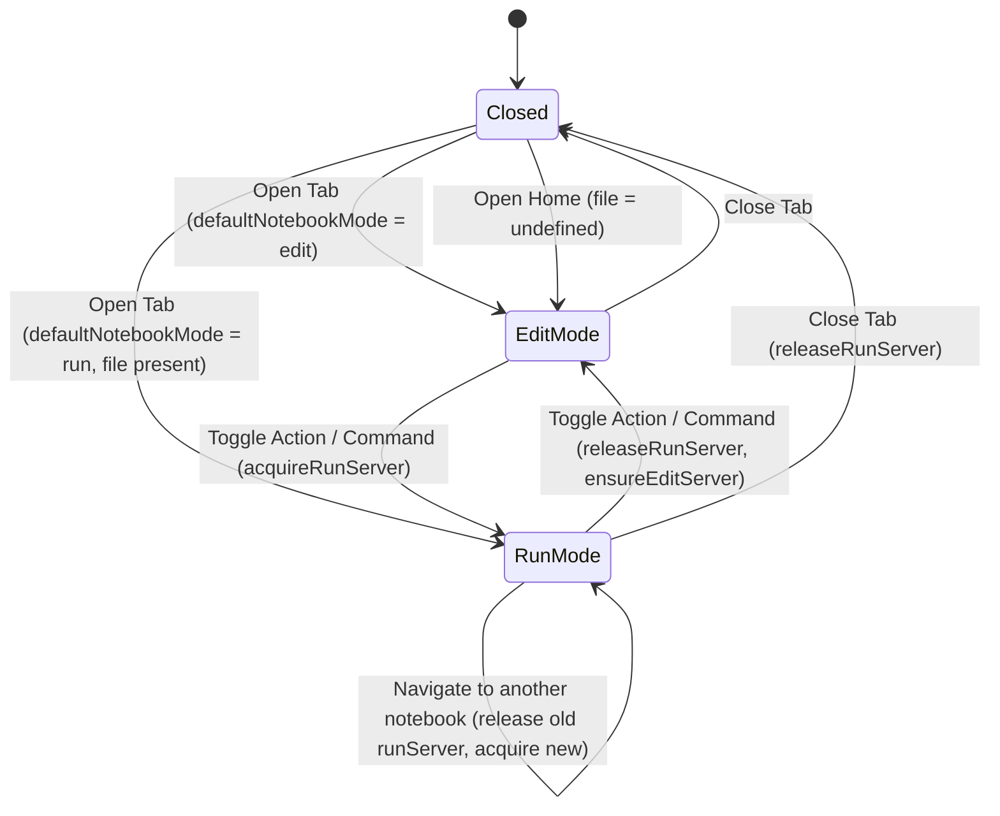

# Data Model: Notebook Tab Edit/Run Mode Selection

**Feature**: Notebook Tab Edit/Run Mode Selection  
**Branch**: `032-notebook-tab-mode`  
**Date**: 2026-10-30  

## Entities

### 1. NotebookTabModeSetting

Represents the persistent global preference configured by the user in plugin settings.

- **Field**: `defaultNotebookMode`
- **Type**: `"edit" | "run"`
- **Default**: `"edit"`
- **Storage**: Obsidian plugin data storage (`data.json` via `MarimoBridgeSettings`).
- **Validation**:
  - Must be either `"edit"` or `"run"`.
  - Fallback to `"edit"` if undefined or unrecognized.

### 2. MarimoViewState

Represents the ephemeral and serialized state of an individual workspace leaf hosting `MarimoEditorView`.

- **Fields**:
  - `file?: string`: Vault-relative path to the notebook `.py` file. If omitted or undefined, represents the Marimo Home view.
  - `mode?: "edit" | "run"`: The explicit mode requested for this tab.
- **Resolution Rules**:
  1. If `file` is undefined/falsy: Effective mode is always `"edit"` (Marimo Home does not support standalone run mode).
  2. If `mode` is defined (`"edit"` or `"run"`): Effective mode is `mode`.
  3. Otherwise: Effective mode defaults to `settings.defaultNotebookMode` (or `"edit"` if unset).

### 3. RunServerLease

Represents a temporary lease on a dedicated `marimo run` server managed by `ServerManager`.

- **Holder**: `MarimoEditorView` instance.
- **Attributes**:
  - `acquiredRunServerFile: string | null`: The vault-relative notebook path for which a lease is currently held by this view instance.
- **Lifecycle & Invariants**:
  - **Acquisition**: When `MarimoEditorView` renders in `"run"` mode for a notebook `currentFile`, it calls `servers.ensureRunServer(currentFile)`. Upon success, `acquiredRunServerFile` is set to `currentFile`.
  - **Release on Switch**: When `MarimoEditorView` switches to `"edit"` mode or switches to a different file in `"run"` mode, any previously held `acquiredRunServerFile` must be released via `servers.releaseRunServer(acquiredRunServerFile)`.
  - **Release on Close**: When the tab leaf is closed (`onClose()`), any active `acquiredRunServerFile` must be released via `servers.releaseRunServer(acquiredRunServerFile)` and set to `null`.
  - **Idempotency**: `releaseRunServer` must never be called multiple times for a single acquisition, and never called when `acquiredRunServerFile` is `null`.

## State Transitions

